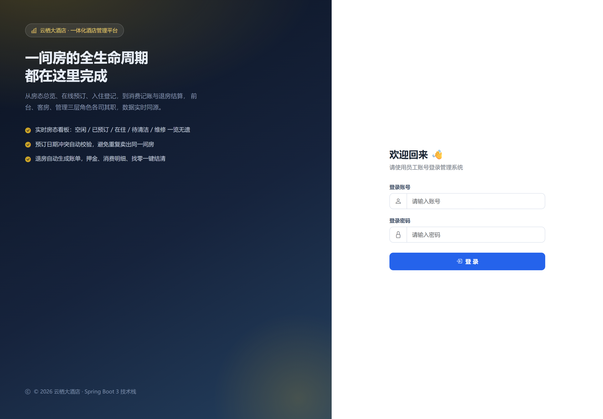

# 酒店管理系统 — IntelliJ IDEA 本地部署文档

> 适用版本：v1.0.0 ｜ 技术栈：Spring Boot 3.3.5 + Thymeleaf + Spring Security 6 + Spring Data JPA + MySQL 8/9
> 文档目标：在 Windows / macOS / Linux 上，用 IntelliJ IDEA 把本项目跑起来并完成验证。

---

## 一、环境要求

| 组件 | 版本要求 | 说明 |
| --- | --- | --- |
| JDK | **21 及以上，至 27 均已验证** | `pom.xml` 中 `<java.version>21</java.version>`，编译产物固定为 Java 21 字节码（major 65） |
| Maven | 3.8+（推荐 3.9.x） | 项目**未附带** `mvnw` 包装器，需本机安装 Maven 或使用 IDEA 内置 Maven |
| MySQL | 8.0 / 9.x | 需要 MySQL 服务处于运行状态 |
| IDEA | 2023.3+（推荐 2024.1+） | 社区版（Community）即可，无框架专属需求 |

> **JDK 高版本注意**：本项目已把 Lombok 显式锁定为 `1.18.48`（见 `pom.xml` 的 `lombok.version`），
> 因此在 JDK 21 / 27 下均可正常编译。**请勿删除该属性** —— Spring Boot 3.3.5 默认托管的 Lombok 1.18.34
> 只支持到 JDK 22，在 JDK 23+ 上会直接编译失败（详见 7.11）。

**快速自检**（命令行）：

```bash
java -version     # 期望输出 openjdk version "21.x"
mvn -v            # 期望 Apache Maven 3.9.x + Java version: 21
mysql --version   # 期望 Ver 8.0.x / 9.x
```

> 若 `mvn -v` 显示的 Java 版本不是 21，说明 `JAVA_HOME` 指向了别的 JDK。Maven 与 IDEA 使用的 JDK 必须一致，否则会出现 `无效的目标发行版: 21` 或 Lombok 注解处理器报错。

---

## 二、准备数据库

### 2.1 启动 MySQL 服务

```bash
# Windows（管理员 PowerShell）
net start MySQL80          # 服务名以实际安装为准，可用 services.msc 查看
# macOS
brew services start mysql
# Linux
sudo systemctl start mysqld
```

### 2.2 关于建库：**不需要手动建库**

JDBC URL 中带了 `createDatabaseIfNotExist=true`，首次启动会自动创建库 `hotel_management`；
表结构由 JPA 的 `ddl-auto: update` 自动生成；演示数据由 `DataInitializer` 自动灌入。

> 如果连接账号没有 `CREATE` 权限，则需手动建库（见下方 2.3）。

### 2.3 手动建库（可选 / 权限受限时）

```sql
CREATE DATABASE IF NOT EXISTS hotel_management
  DEFAULT CHARACTER SET utf8mb4
  DEFAULT COLLATE utf8mb4_general_ci;
```

### 2.4 核对连接信息

打开 `src/main/resources/application.yml`，确认以下四项与你的本机一致：

```yaml
spring:
  datasource:
    url: jdbc:mysql://127.0.0.1:3306/hotel_management?...   # 主机 / 端口 / 库名
    username: root
    password: "123456"                                      # 改成你的真实密码
```

| 参数 | 默认值 |
| --- | --- |
| 主机端口 | `127.0.0.1:3306` |
| 库名 | `hotel_management` |
| 账号 | `root` |
| 密码 | `123456` |

> **不要直接改 application.yml 提交到 Git**。推荐用运行配置里的环境变量覆盖（见 4.3），这样密码不会进版本库。

---

## 三、在 IDEA 中导入项目

### 3.1 打开项目

1. IDEA 启动页 → **Open**（不要选 New Project）
2. 选择项目根目录 —— **即包含 `pom.xml` 的那一层**（`hotel-management-system/`）
3. 弹窗询问时选择 **Trust Project**
4. IDEA 识别到 `pom.xml` 后会自动开始 Maven 导入，右下角出现进度条；等待依赖下载完成

### 3.2 配置 Project SDK

`File → Project Structure`（快捷键 `Ctrl+Alt+Shift+S`）→ **Project**：

| 项 | 设置值 |
| --- | --- |
| SDK | 21（没有则 `Add SDK → Download JDK` 选 21） |
| Language level | **21 - Records, patterns, ...** |

→ 切到 **Modules → 你的模块 → Sources**，确认 Language level 同为 21。

> **没有独立 JDK 时**：若本机只装了 IntelliJ IDEA，可使用其自带 JBR（21，含 `javac`）：`Add SDK → JDK → 选择 IDEA 安装目录下的 jbr 文件夹`。已验证可用于本项目。

### 3.3 确认编码

`Settings → Editor → File Encodings`：

- Global Encoding：**UTF-8**
- Project Encoding：**UTF-8**
- Default encoding for properties files：**UTF-8**，并勾选 **Transparent native-to-ascii conversion**

> 本项目页面全是中文，编码不对会出现乱码或 Thymeleaf 模板解析 500。

### 3.4 确认 Lombok 生效

项目大量使用 Lombok（`@Getter/@Setter/@Slf4j/@RequiredArgsConstructor`），必须让 IDEA 识别：

1. `Settings → Plugins` 搜索 **Lombok**，确认已启用（2023.3+ 已内置，通常无需手动装）
2. `Settings → Build → Compiler → Annotation Processors` → 勾选 **Enable annotation processing**
3. `Settings → Build → Build Tools → Maven → Importing` → 勾选 **Automatically download: Sources / Documentation**（可选）

> 报 `找不到符号: 方法 getXxx()` 或 `log` 变量不存在，基本都是这一步没配好。

### 3.5 Maven 加速（中国大陆网络建议）

`Settings → Build → Build Tools → Maven`：

- **Maven home path**：`Bundled (Maven 3)` 或本机 Maven 均可
- **User settings file**：勾选 Override，指向 `~/.m2/settings.xml`

在 `~/.m2/settings.xml` 中加入阿里云镜像：

```xml
<settings>
  <mirrors>
    <mirror>
      <id>aliyun-public</id>
      <mirrorOf>central</mirrorOf>
      <name>aliyun public</name>
      <url>https://maven.aliyun.com/repository/public</url>
    </mirror>
  </mirrors>
</settings>
```

改完在 Maven 面板点 **Reload All Maven Projects**（🔄 图标）。

---

## 四、配置运行方式

### 4.1 方式 A：用 IDEA 内置 Spring Boot 面板（推荐）

1. 打开启动类 `src/main/java/com/hotel/hms/HotelManagementApplication.java`
2. 点击行号旁的 **绿色三角** → **Run 'HotelManagementApplication'**
3. IDEA 自动创建 Run Configuration，直接跑即可

### 4.2 方式 B：手动创建 Run Configuration

`Run → Edit Configurations → + → Spring Boot`（或 Application）：

| 字段 | 值 |
| --- | --- |
| Name | `HotelManagementApplication` |
| Main class | `com.hotel.hms.HotelManagementApplication` |
| Use classpath of module | `hotel-management-system` |
| JRE | 21 |
| Working directory | `$PROJECT_DIR$`（项目根目录） |

> ⚠️ **Working directory 必须设为项目根目录**。虽然本项目用 `classpath:` 读取模板与静态资源、不依赖工作目录，但保持惯例可避免后续加文件上传等功能时踩坑。

### 4.3 覆盖敏感配置（不改 application.yml）

在 Run Configuration 的 **Environment variables** 中填：

```
SPRING_DATASOURCE_PASSWORD=你的真实密码;SPRING_DATASOURCE_USERNAME=root
```

（多条用 `;` 分隔，Windows 用 `;`，macOS/Linux 用 `:`）

如果嫌麻烦，也可以直接改 `application.yml`，但**注意不要提交**：

```bash
git update-index --skip-worktree src/main/resources/application.yml
```

### 4.4 命令行启动（不依赖 IDEA，用于对比排查）

```bash
# 项目根目录下
mvn clean package -DskipTests
java -jar target/hotel-management-system.jar --server.port=8080
```

---

## 五、启动与访问

启动成功后，控制台**最后**会打印一段启动横幅，直接给出入口链接：

```
  ✔ 云栖大酒店 · 酒店管理系统 启动成功
════════════════════════════════════════════════════════════════
  访问入口    http://localhost:8080/login
  数据看板    http://localhost:8080/dashboard
  局域网访问  http://192.168.1.5:8080/login
────────────────────────────────────────────────────────────────
  演示账号    admin / admin123              （管理员）
              reception / 123456            （前台）
              housekeeping / 123456         （客房）
              supervisor / 123456           （客房主管）
════════════════════════════════════════════════════════════════
```

在此之前还会看到这几行关键日志：

```
已创建默认账号 admin / admin123
演示数据初始化完成。
Tomcat started on port 8080 (http)
Started HotelManagementApplication in x.xxx seconds
```

> **横幅里的端口是真实端口**，取自实际启动的 Web 容器，而不是配置文件里的字面值。
> 所以用 `--server.port=9090` 或环境变量 `SERVER_PORT` 覆盖端口后，打印出来的地址依然是对的。
> 局域网地址取自本机非回环网卡（最多 3 个），手机/同事可以用它访问。
>
> 不想看到这段横幅？`application.yml` 里设 `hotel.startup.print-banner: false` 即可（业务日志不受影响）。

浏览器访问：**http://localhost:8080**

### 演示账号

> 登录页**不再展示**演示账号，全部账号信息以下表（及启动控制台横幅）为准。

| 角色 | 账号 | 密码 | 可访问范围 |
| --- | --- | --- | --- |
| 管理员 | `admin` | `admin123` | 全部功能，含账号权限与操作日志 |
| 前台接待 | `reception` | `123456` | 预订 / 入住 / 退房 / 结账 / 客户 / 房态 / 收款流水 / 交接班 / 发票 / 应收 / 房价方案 / 团队 |
| 客房服务 | `housekeeping` | `123456` | 客房全流程（工单完成 / 迷你吧 / 洗衣布草 / 维修 / 失物 / 查房 / 移动端上报 / 待办）；**不能建房 / 派工 / 验收，看板不显示任何金额** |
| 客房主管 | `supervisor` | `123456` | 客房服务的**全部权限**（`RoleHierarchy` 自动继承）+ 派工 / 验收 / 检查单模板 / 排班 / 耗材建档 / 布草外送结算；**进不了前台资金模块与客户 / 订单 / 账单 / 账号** |

登录页实拍（账号区块已移除）：



> 首次启动会自动灌入 5 种房型、40 间客房、8 位客户、10 笔订单及对应账单，便于直接体验。
> `DataInitializer` 带**幂等保护**：房型表非空则跳过业务数据，账号按用户名存在则跳过 —— **重复启动不会灌重复数据**。

---

## 六、启动后验证清单

按顺序点一遍，确认部署成功：

| # | 操作 | 期望结果 |
| --- | --- | --- |
| 1 | 打开 `http://localhost:8080` | 自动跳转登录页，显示「云栖大酒店」 |
| 2 | 用 `admin / admin123` 登录 | 进入数据看板，显示入住率、营收趋势图 |
| 3 | 左侧「房态一览」 | 按楼层平铺 40 间房，五色状态标识 |
| 4 | 「预订管理 → 新增预订」 | 选日期后房型/房价自动联动，晚数×房价实时计算 |
| 5 | 对一条「已预订」订单点「办理入住」 | 状态变「已入住」，房态图对应房间转红 |
| 6 | 「办理退房」 | 跳转账单页，自动生成房费明细 |
| 7 | 新增一条消费 → 点「结账」 | 账单状态变「已结账」，显示收款记录 |
| 8 | 退出，用 `housekeeping / 123456` 登录后访问 `/customers` | 跳转 403 无权限页 |

自动化回归脚本（应用需运行在 8080）：

```bash
bash scripts/func-test.sh
# 期望输出：结果：PASS=17  FAIL=0
```

---

## 七、常见问题排查

### 7.1 端口被占用：`Port 8080 was already in use`

```bash
# Windows
netstat -ano | findstr :8080
taskkill /F /PID <上一步查到的PID>
# macOS / Linux
lsof -i :8080
kill -9 <PID>
```

或改端口：Run Configuration → VM options 加 `-Dserver.port=8081`，或命令行 `--server.port=8081`。

### 7.2 `Communications link failure` / `Unable to connect to MySQL`

按顺序排查：

1. MySQL 服务是否在跑（`net start MySQL80` / `systemctl status mysqld`）
2. 端口是否是 3306（`netstat -ano | findstr :3306`）
3. 账号密码是否正确 —— 命令行直连验证：
   ```bash
   mysql -u root -p123456 -h 127.0.0.1 -P 3306 -e "SELECT VERSION();"
   ```
4. MySQL 8/9 的 `caching_sha2_password` 认证：本项目 URL 已带 `allowPublicKeyRetrieval=true&useSSL=false`，一般无需额外处理

### 7.3 `Access denied for user 'root'@'localhost'`

密码不对或账号无权限。用 `mysql -u root -p` 登录后确认：

```sql
SELECT user, host, plugin FROM mysql.user WHERE user = 'root';
```

### 7.4 编译报 `找不到符号: getXxx()` / `log` 不存在

Lombok 未生效 → 回到 **3.4** 逐项检查（插件 + Enable annotation processing），然后 `Build → Rebuild Project`。

> 若报的是一长串 `ExceptionInInitializerError` + `TypeTag :: UNKNOWN`，那**不是**配置问题，而是 JDK 版本不兼容，见 **7.11**。

### 7.5 `无效的目标发行版: 21` / `has been compiled by a more recent version`

Maven 用的 JDK 不是 21。检查：

```bash
mvn -v            # 看 Java version
echo $JAVA_HOME   # Windows: echo %JAVA_HOME%
```

修正 `JAVA_HOME` 后，IDEA 中 `Settings → Build → Build Tools → Maven → Runner → JRE` 也要设为 21。

### 7.6 页面 404 / 静态资源加载不出来

- 确认是 `classpath:/static/` 下的资源，且 `application.yml` 中 `spring.web.resources.static-locations` 未被改坏
- IDEA 中执行 `Build → Rebuild Project`，避免旧的 `target/classes` 残留
- 浏览器强刷 `Ctrl+F5` 清掉 CSS/JS 缓存

### 7.7 Thymeleaf 报模板解析错误 / 页面 500

本项目 `spring.thymeleaf.cache: false` 已关闭模板缓存，改 HTML 后刷新即可生效。若仍 500，看控制台堆栈定位到具体模板行；常见原因是自定义 `th:` 属性里的表达式引号不配对。

### 7.8 中文乱码

**3.3** 的编码设置 + 确认 IDEA 右下角状态栏显示 **UTF-8**。命令行启动时补 `-Dfile.encoding=UTF-8`：

```bash
java -Dfile.encoding=UTF-8 -jar target/hotel-management-system.jar
```

### 7.9 想清空数据重新初始化

```sql
DROP DATABASE hotel_management;
```

重启应用即可 —— 会自动重建库、重建表并重新灌入演示数据。（也可以只清空表：`SET FOREIGN_KEY_CHECKS=0;` 后逐表 `TRUNCATE`，再 `SET FOREIGN_KEY_CHECKS=1;`）

### 7.10 不想灌演示数据

`application.yml` 中改为：

```yaml
hotel:
  init-demo-data: false    # 只初始化三个账号，不灌房型/客房/订单
```

### 7.11 ⭐ `java.lang.ExceptionInInitializerError` / `com.sun.tools.javac.code.TypeTag :: UNKNOWN`

**完整报错**：

```
java: java.lang.ExceptionInInitializerError
com.sun.tools.javac.code.TypeTag :: UNKNOWN
```

**根因**：Lombok 版本与编译所用 JDK 不兼容。Lombok 需要 hook javac 内部 API，
JDK 大版本升级会改动这些内部结构，版本不匹配时 Lombok 初始化直接崩掉。

具体到本项目：Spring Boot 3.3.5 默认托管的 Lombok 是 **1.18.34**，最高只支持到 **JDK 22**。
若 IDEA 的 Project SDK 指向 **JDK 23 及以上**（例如本机装了 JDK 27），就会报出这个错。

> 由于 IDEA 编译用的是「Project SDK」而不是命令行 `JAVA_HOME`，所以经常出现
> **命令行 `mvn` 能跑通、IDEA 里却编译失败** 的现象 —— 两者用的不是同一个 JDK。

**已验证的修复方案（推荐，改一处即可）**：

`pom.xml` 的 `<properties>` 中显式锁定 Lombok 版本，覆盖 Spring Boot 的托管值：

```xml
<properties>
    <java.version>21</java.version>
    <lombok.version>1.18.48</lombok.version>   <!-- 支持 JDK 21 ~ 27 -->
</properties>
```

改完在 IDEA 中：

1. Maven 面板点 **Reload All Maven Projects**（🔄）
2. `Build → Rebuild Project`
3. 若仍报错，`File → Invalidate Caches → Invalidate and Restart`

**备选方案**：把 IDEA 的 Project SDK 降到 21（见 3.2）。本项目声明的是 Java 21，
用 21 编译最省事；但如果本机只装了高版本 JDK，用上面的 Lombok 升级方案即可，无需额外装 JDK。

**验证是否修好**（命令行可独立复现，不依赖 IDEA）：

```bash
mvn clean package -DskipTests          # 期望 BUILD SUCCESS
javap -verbose -cp target/classes com.hotel.hms.entity.Room | grep "major version"
# 期望：major version: 65  ← 即 Java 21 字节码
```

> 实测结论：JDK 21 与 JDK 27 下 `mvn clean package` 均 BUILD SUCCESS，产物字节码均为 major 65。

---

## 八、打包与独立部署

```bash
# 项目根目录执行
mvn clean package -DskipTests

# 产物（Spring Boot 可执行 fat jar，约 52 MB）
ls -lh target/hotel-management-system.jar

# 运行
java -jar target/hotel-management-system.jar --server.port=8080
```

后台常驻运行：

```bash
# Linux / macOS
nohup java -jar target/hotel-management-system.jar > app.log 2>&1 &

# Windows（PowerShell）
Start-Process -NoNewWindow -RedirectStandardOutput app.log `
  -FilePath java -ArgumentList '-jar','target\hotel-management-system.jar'
```

> 打包用到 `spring-boot-maven-plugin`，已配置 `<finalName>` 为 `hotel-management-system`，因此产物名固定，不随版本号变化。

---

## 九、关键配置速查表

| 配置项 | 文件 / 位置 | 默认值 |
| --- | --- | --- |
| 服务端口 | `application.yml` → `server.port` | `8080` |
| 上下文路径 | `application.yml` → `server.servlet.context-path` | `/` |
| 数据库 URL | `application.yml` → `spring.datasource.url` | `jdbc:mysql://127.0.0.1:3306/hotel_management` |
| 数据库账号/密码 | `application.yml` → `spring.datasource.username/password` | `root` / `123456` |
| 建表策略 | `application.yml` → `spring.jpa.hibernate.ddl-auto` | `update` |
| 模板缓存 | `application.yml` → `spring.thymeleaf.cache` | `false`（改页面免重启） |
| 演示数据开关 | `application.yml` → `hotel.init-demo-data` | `true` |
| 预订最大提前天数 | `application.yml` → `hotel.max-advance-days` | `365` |
| 启动横幅开关 | `application.yml` → `hotel.startup.print-banner` | `true`（启动时打印入口链接） |
| 启动类 | `src/main/java/com/hotel/hms/HotelManagementApplication.java` | — |
| 打包产物 | `target/hotel-management-system.jar` | — |

---

## 十、目录结构参考

```
hotel-management-system/
├── pom.xml                       # Maven 配置（Java 21 + Spring Boot 3.3.5）
├── README.md
├── docs/
│   ├── IDEA-本地部署文档.md        # 本文档
│   └── screenshots/              # 页面截图 13 张
├── scripts/
│   └── func-test.sh              # 端到端回归测试（17 项断言）
└── src/main/
    ├── java/com/hotel/hms/
    │   ├── HotelManagementApplication.java   # ← 启动类
    │   ├── config/        # Security、数据初始化、全局 Model 属性
    │   ├── controller/    # MVC 控制器
    │   ├── service/       # 业务层（状态流转 / 事务 / 校验）
    │   ├── repository/    # Spring Data JPA
    │   ├── entity/        # 实体与枚举
    │   ├── dto/           # 表单与统计对象
    │   └── common/        # 业务异常与全局异常处理
    └── resources/
        ├── application.yml               # ← 主要配置文件
        ├── templates/                    # Thymeleaf 页面
        └── static/                       # CSS / JS / vendor（Bootstrap、Chart.js）
```
